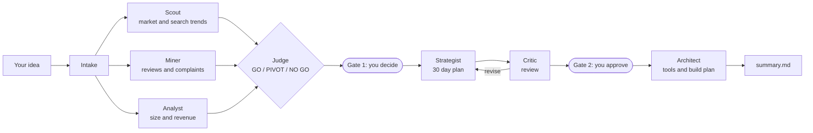

<div align="center">

# 🏭 Startup Factory

**Give it a niche. Get an honest answer on whether it is worth your next 30 days.**

A team of seven AI agents researches the market, mines real customer complaints, sizes the money, judges the evidence and writes a 30 day validation plan you can start tomorrow.


</div>

---

## ⚡ Direct start

**Codex, in any project folder:**

```bash
npx skills add tiagoapolo/startup-factory-skill --skill factory -a codex
```

```bash
codex --search
```

Then type:

```
$factory invoicing for freelance designers in Brazil
```

That is it. On the first run the skill installs its seven specialists into `.codex/agents/` and creates `founder.md` for you. If Codex says the agents are not loaded, restart it once.

**Claude Code:**

```bash
git clone https://github.com/tiagoapolo/startup-factory-skill.git
```

```bash
cd startup-factory-skill && claude
```

Then type:

```
/factory invoicing for freelance designers in Brazil
```

> 💡 Fill in `founder.md` first, or let the factory ask you. Your weekly hours and your budget shape the whole plan.

---

## 🎯 Why use it

* **It says no.** Most ideas should fail, and the judge is built to kill them early. A NO GO on day one saves you a month.
* **Evidence, not vibes.** Every claim has a source link. Every estimate is marked ESTIMATE with the math shown. Nothing is invented.
* **Three signals, not one.** Demand counts as real only when at least two of these agree: search trends, customer complaints and competitor revenue.
* **You stay in charge.** The factory stops at two gates and whenever direction is in doubt. It never contacts anyone, publishes anything or spends money.
* **You get a plan, not a report.** Thresholds that decide pass or fail, a daily calendar, copy you can paste and the tools to build with.

---

## 🧭 How it works



| Agent | What it does | Writes |
| :- | :- | :- |
| 🔭 **Scout** | Maps competitors and pricing, runs search trend analysis | `research/market.md` |
| ⛏️ **Miner** | Reads reviews and forums for real complaints and gaps | `research/pains.md` |
| 📊 **Analyst** | Sizes the market, estimates competitor revenue from traffic | `research/viability.md` |
| ⚖️ **Judge** | Checks the sources, scores each problem, gives the verdict | `verdict.md` |
| 🗺️ **Strategist** | Writes the 30 day validation and campaign plan | `plan.md` |
| 🔍 **Critic** | Stress tests the plan, sends it back up to two times | `review.md` |
| 🛠️ **Architect** | Picks existing tools for the test and the first version | `build.md` |

---

## 📁 What you get

Every idea gets its own folder, so you can run several side by side.

```
runs/20261116_invoicing_designers/
├── brief.md            the idea, the customer, your constraints
├── research/
│   ├── market.md       competitors, pricing, search demand
│   ├── pains.md        ranked problems in customers' own words
│   └── viability.md    market size, revenue estimates, risks
├── verdict.md          GO, PIVOT or NO GO, with scores
├── plan.md             the 30 day plan with thresholds and copy
├── review.md           what the critic found
├── build.md            the stack and what it costs per month
├── summary.md          one page to read first
├── decisions.md        every answer you gave
└── state.json          where the run stopped, so you can resume
```

---

## 🕹️ Commands

| Codex | Claude Code | What it does |
| :- | :- | :- |
| `$factory <idea>` | `/factory <idea>` | Start a new run |
| `$factory status` | `/factory status` | List every run and its stage |
| `$factory resume <run>` | `/factory resume <run>` | Continue where a run stopped |

---

## ⚙️ Good to know

<details>
<summary><b>Codex notes</b></summary>

* The researchers need live pages. Start Codex with `--search`, or put `web_search = "live"` in your `.codex/config.toml`. This repo already has that file.
* Questions come as numbered options in the chat. Reply with a number.
* Codex does not limit where an agent writes. Each agent is told to write only inside its run folder, but nothing enforces it. Check the diff of a run before you commit it.
* The agents use your session's model. The judge and the critic keep high reasoning effort. To give them a stronger model, fill `CODEX_MODELS` in `scripts/sync_codex.py` and run it.

</details>

<details>
<summary><b>Claude Code notes</b></summary>

* Claude Code asks you to trust the folder the first time. `.claude/settings.json` lets the agents search the web and write inside `runs/` without asking each time. Remove a line if you prefer to approve those yourself.
* Researchers, the strategist and the architect run on Sonnet. The judge and the critic run on Opus with high effort, because a wrong verdict costs you a month. Change the `model` line in `.claude/agents/` to adjust.

</details>

<details>
<summary><b>Changing the factory</b></summary>

* `.claude/agents/` is the source of truth for the specialists. After you edit one, run `python3 scripts/sync_codex.py` to rebuild the Codex versions in `skills/factory/specialists/`.
* To change how ideas are scored, edit the criteria in `.claude/agents/judge.md`.
* To change when you are asked, edit the "Checkpoint policy" in both skills: `skills/factory/SKILL.md` and `.claude/skills/factory/SKILL.md`.
* Shared rules for every agent live in `AGENTS.md`.

</details>

---

<div align="center">

**Most ideas should fail. Find out which ones in a day, not a month.**

</div>
